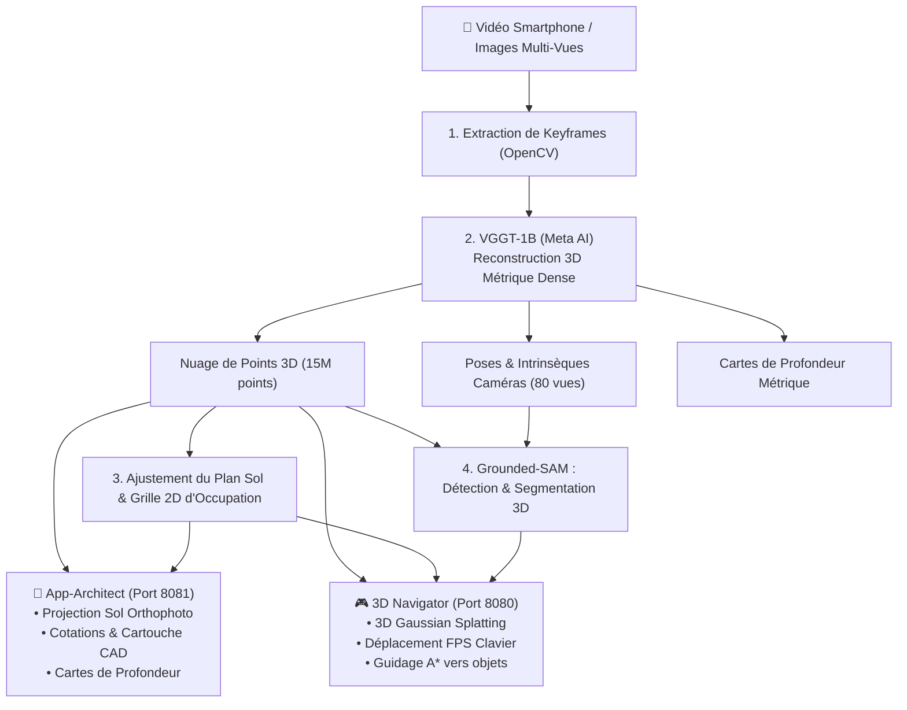

# 🏛️ 3D Scene Navigator & App-Architect

[](https://www.python.org/downloads/)
[](https://pytorch.org/)
[](https://github.com/facebookresearch/vggt)
[](https://viser.studio/)
[](LICENSE)

Système de **reconstruction 3D métrique, d'estimation de plans d'architecte (style ArchiCAD), d'analyse de profondeur et de navigation interactive**, à partir d'une simple vidéo smartphone ou d'une série d'images.

---

## ✨ Fonctionnalités Principales

### 1. 📐 App-Architect : Studio de Relevé & Plans d'Étage (Port 8081)
- **Projection 3D directe au sol (Vue Orthophoto Réelle)** : Projection orthogonale des 15 millions de points 3D pour voir la vraie pièce vue du dessus (textures réelles du sol, forme exacte du lit, bureau, ouvertures).
- **Cotations d'architecte automatiques** : Chaînes de côtes professionnelles avec traits à 45° et lignes de rappel mesurant la largeur totale, longueur totale et surface en m².
- **Modes de rendu d'étage** :
  - `📸 Projection 3D Réelle` (Orthophoto RGB haute fidélité)
  - `📡 Scanner Laser` (Coloration spectrale par hauteur de points)
  - `🔵 Blueprint CAD` (Style tirage de plan bleu technique)
  - `📐 Plan Vectoriel Schématique` (Style ArchiCAD papier blanc)
- **Visionneuse de profondeur & Multi-vues** : Inspection instantanée des 80 caméras avec affichage synchronisé de l'image RGB et de sa carte de profondeur métrique colorisée (colormap Turbo).
- **Alignement 3D "Vue du dessus"** : Bouton 1-clic pour orienter instantanément la caméra 3D interactive au plafond face au sol.
- **Export 1-clic** : Téléchargement direct du plan au format PNG haute résolution (1500×1100).

### 2. 🎮 3D Scene Navigator & FPS Walk (Port 8080)
- **Rendu photoréaliste 3D** : Affichage temps réel de nuages de points denses et de **3D Gaussian Splatting (3DGS)** via `gsplat`.
- **Mode exploration 1ère personne (Jeu Vidéo)** : Déplacement fluide à l'intérieur de la pièce avec les touches **Z / Q / S / D** (ou **Flèches directionnelles**).
- **Détection & Segmentation d'objets 3D** : Découverte open-vocabulary de mobilier (Lit, Bureau, Fauteuil, Étagères, Portes, Fenêtres) via Grounded-SAM.
- **Guidage & Planification de trajectoire A\*** : Calcul automatique du chemin piéton optimal depuis l'entrée vers n'importe quel meuble sélectionné.
- **Minimap HUD interactive** : Carte 2D d'occupation épinglée en haut à gauche avec affichage de la position et de l'orientation en temps réel.

---

## 🏗️ Architecture du Pipeline



---

## 📋 Prérequis & Matériel

- **Système d'exploitation** : Linux (Ubuntu 20.04+, Debian, etc.) ou WSL2
- **GPU recommandé** : NVIDIA RTX 3080, 3090, 4090, A5000, A6000 (12 Go+ VRAM recommandé)
- **CUDA** : CUDA 12.1 ou CUDA 12.4+
- **Python** : 3.10 ou supérieur

---

## ⚡ Installation Rapide (1-Clic)

### Méthode 1 : Script d'installation automatique
```bash
git clone https://github.com/<votre-utilisateur>/3d-scene-navigator.git
cd 3d-scene-navigator

# Rendre le script exécutable et lancer l'installation
chmod +x setup.sh
./setup.sh
```

### Méthode 2 : Installation manuelle via venv
```bash
python3 -m venv .venv
source .venv/bin/activate

# Installer PyTorch avec support CUDA
pip install torch torchvision --index-url https://download.pytorch.org/whl/cu124

# Installer les dépendances du projet
pip install -r requirements.txt

# Installer la fondation VGGT
git clone https://github.com/facebookresearch/vggt.git vggt
pip install -e vggt
```

---

## 🚀 Utilisation

### 1. Lancer l'App-Architect (Studio de Relevé & Plans CAD)
```bash
source .venv/bin/activate
python app_architect.py --port 8081
```
👉 Ouvrez votre navigateur sur **`http://localhost:8081`**

### 2. Lancer le 3D Scene Navigator (Navigation FPS & 3DGS)
```bash
source .venv/bin/activate
python app.py --port 8080
```
👉 Ouvrez votre navigateur sur **`http://localhost:8080`**

### 3. Accès distant via Tunnel SSH (Serveur GPU distant)
Si vous travaillez sur un serveur distant sans interface graphique :
```bash
ssh -N -L 8080:localhost:8080 -L 8081:localhost:8081 user@ip-du-serveur
```

---

## 🎬 Traiter une Nouvelle Vidéo

Pour reconstruire une nouvelle pièce à partir d'un fichier vidéo :

```bash
python process_video.py \
    --video /chemin/vers/ma_video.mp4 \
    --num-frames 80 \
    --output-cache data/scene_cache.pt \
    --output-depth data/depth_maps
```

Options utiles :
- `--num-frames 80` : Nombre d'images clés extraites de la vidéo (défaut : 80).
- `--no-segment` : Passe l'étape SAM pour une reconstruction ultra-rapide (< 1 minute).
- `--classes "bed, chair, desk, door, window"` : Restreindre la recherche à des meubles spécifiques.

---

## 🎮 Commandes du Mode Visite Virtuelle (FPS)

Dans l'application 3D Navigator (`http://localhost:8080`) :
| Touche | Action |
| :---: | :--- |
| **Z** ou **Flèche Haut** | Avancer dans la pièce |
| **S** ou **Flèche Bas** | Reculer |
| **Q** ou **Flèche Gauche** | Pas latéral gauche (Strafe) |
| **D** ou **Flèche Droite** | Pas latéral droit (Strafe) |
| **A / E** | Tourner la tête à gauche / à droite |
| **Bouton Souris Gauche** | Orienter le regard en orbite |
| **Bouton Souris Droit** | Déplacer le plan de vue |
| **Molette** | Zoom / Dézoom |

---

## 📂 Structure du Répertoire

```text
3d-scene-navigator/
├── app.py                     # Serveur Web 3D Navigator (3DGS + Visite FPS + A*)
├── app_architect.py           # Serveur Web App-Architect (Plans 2D, Cotations, Profondeurs)
├── app-architect              # Script de lancement rapide en ligne de commande
├── process_video.py           # CLI de traitement vidéo de bout en bout
├── extract_video_frames.py    # Découpage intelligent de vidéo en images clés
├── train_3dgs.py              # Entraînement 3D Gaussian Splatting (gsplat)
├── setup.sh                   # Script d'installation automatique 1-clic
├── requirements.txt           # Dépendances Python
├── environment.yml            # Fichier d'environnement Conda
├── .gitignore                 # Fichiers volumineux / caches ignorés
│
├── src/
│   ├── reconstruction/        # Module d'inférence VGGT (Meta AI)
│   ├── segmentation/          # Grounded-SAM & levée 3D volumétrique
│   ├── mapping/               # Détection plan sol & grille d'occupation
│   ├── planning/              # Algorithme de navigation A* lissé
│   ├── architect/             # Moteur de rendu de plans CAD (BlueprintRenderer)
│   └── pipeline.py            # Pipeline global SceneNavigator
│
└── data/                      # Données de scène locales (ignorées par git)
    ├── custom_frames/         # Images extraites
    ├── depth_maps/            # Cartes de profondeur métrique colorisées
    └── scene_cache.pt         # Cache de scène accéléré (chargement en 3s)
```

---

## 📜 Remerciements & Technologies

Ce projet intègre les technologies de pointe suivantes :
- **[VGGT](https://github.com/facebookresearch/vggt)** (Meta AI Research) : Modèle de fondation pour la géométrie et la reconstruction 3D de scènes.
- **[Viser](https://viser.studio/)** : Visualiseur 3D interactif et interface WebUI ultra-rapide.
- **[gsplat](https://github.com/nerfstudio-project/gsplat)** : Rasterisation différentiable haute performance pour 3D Gaussian Splatting.
- **[Segment Anything (SAM)](https://github.com/facebookresearch/segment-anything)** & **[Grounding DINO](https://github.com/IDEA-Research/GroundingDINO)** : Segmentation open-vocabulary 2D/3D.

---

## 📄 Licence

Ce projet est sous licence MIT - voir le fichier [LICENSE](LICENSE) pour plus de détails.
